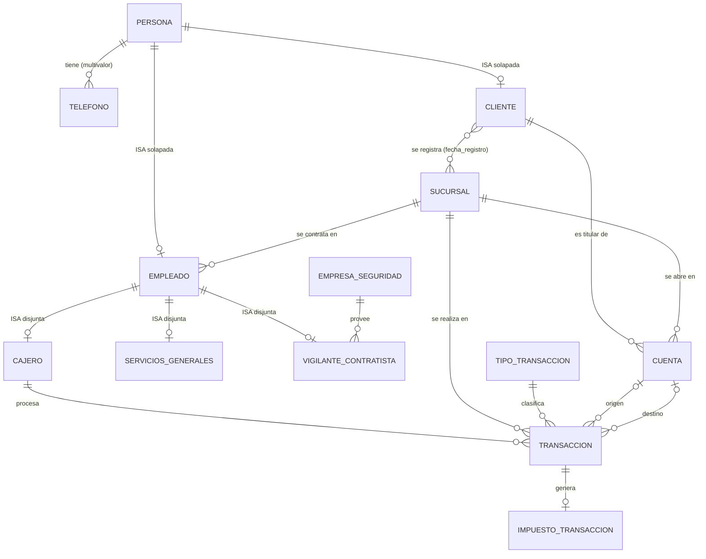

# Banco Sierra Nevada — Correcciones de la Entrega 1

**Proyecto Integrador · Base de Datos I · Entrega 2, punto 1**
Grupo de 2 integrantes · PostgreSQL 16+

Este documento recoge (a) el cambio de alcance por la reducción del grupo, (b) los errores de la Entrega 1 que se corrigieron y por qué, (c) el diagrama EER corregido, y (d) los dos entregables que **no se presentaron** en la Entrega 1: el esquema relacional (punto 4) y el diccionario de datos (punto 5, en `02_diccionario_datos.md`).

---

## 1. Cambio de alcance por la deserción de integrantes

El grupo pasó de 4 a 2 integrantes y, a petición del profesor, el alcance se redujo:

| Aspecto | Entrega 1 | Ahora |
|---|---|---|
| Clientes | Personas naturales y pequeñas empresas | **Solo personas naturales** |
| Productos | Cuentas de ahorro y corriente, tarjetas débito | **Solo cuentas de ahorro** |
| Sobregiro / cupo | Mencionado para cuenta corriente | **No aplica** (saldo mínimo 0) |
| Límite de saldo | No definido | **Sin límite máximo de saldo** |
| Créditos en mora | Mencionados en el planteamiento | **Fuera de alcance** |
| Empleados | Un solo tipo, con salario y horario | **Tres tipos** (ver 2.5) |

---

## 2. Correcciones realizadas

### 2.1 Errores del diagrama EER

| # | Problema en la Entrega 1 | Corrección | Por qué |
|---|---|---|---|
| 1 | La entidad **"Banco Sierra Nevada"** tenía id interno, dirección, horario y nombre: eso describe una **sede**, no el banco. | Se reemplazó por la entidad **SUCURSAL**. | El banco es uno solo; lo que se repite y se relaciona con empleados, clientes y transacciones son las sedes. |
| 2 | **Cuenta de ahorro / Cuenta corriente** colgaban como subtipos de "Banco" (especialización mal dirigida). | Se creó la entidad **CUENTA**, asociada a un cliente. Al salir la cuenta corriente, la especialización desaparece. | Una cuenta no es un tipo de banco; es un producto que pertenece a un cliente. |
| 3 | **"Ingresa dinero"** y **"Retira monto"** eran relaciones N:M entre Usuario y Banco, sin monto ni cuenta. | Se reemplazaron por la entidad **TRANSACCION** (depósito, retiro, transferencia) que referencia cuentas. | Una operación con monto, fecha y empleado es una entidad con historial, no una relación sin atributos. |
| 4 | Faltaban el **impuesto 4x1000** y la trazabilidad por empleado/sucursal, que el planteamiento exige. | Se añadieron **TIPO_TRANSACCION** (con tasa) e **IMPUESTO_TRANSACCION** (impuesto cobrado por cada transacción). | El planteamiento pide registro separado del recaudo y de la transacción sobre la que se cobró. |
| 5 | **Edad** aparecía a la vez como atributo derivado y como atributo normal; **Horario** aparecía dos veces en Empleado. | Edad queda solo como derivado (vista `v_persona_edad`). Se eliminó el horario del empleado. | Un atributo derivado no se almacena; el duplicado era un error de dibujo. |
| 6 | **Salario** y **Contrato** eran atributos simples de Empleado, igual para todos. | Salario pasa a ser **derivado** (salario mínimo del año + bono) y se crean subtipos. `Contrato` pasa a `tipo_contrato`. | Cajeros, servicios generales y vigilantes se pagan distinto; guardar el salario por empleado duplicaría el salario mínimo. |
| 7 | El correo electrónico estaba en los requisitos pero **no en el diagrama**. | Se añadió `correo_electronico` a PERSONA. | Coherencia entre requisitos y diseño. |
| 8 | **Telefono** multivalor estaba bien dibujado pero **sin la tabla** resultante. | Se mapea a `persona_telefono`. | Todo atributo multivalor genera una relación propia. |
| 9 | Las relaciones M:N **no mostraban su tabla intermedia**. | "Se registra" se mapea a `cliente_sucursal`. | Es el error clásico señalado en la guía. |
| 10 | Faltaban **cardinalidades (mín, máx)** en la mayoría de relaciones. | Se agregan en la sección 3. | Requisito de la rúbrica del diagrama EER. |

### 2.2 Contradicciones en el texto

| # | Contradicción | Resolución |
|---|---|---|
| 1 | El **supuesto 4** decía que no se gestionan sucursales ("canal único"), pero el planteamiento y el diagrama sí las usan (empleado "se contrata" en un banco; clientes "se registran"). | **Se revoca el supuesto 4.** Las sucursales se modelan, y cada transacción registra la sucursal y el cajero que la procesó. |
| 2 | El planteamiento describe **pequeñas empresas, cuentas corrientes, tarjetas débito, sobregiro y créditos**, que no aparecen en los requisitos. | Se retiran del planteamiento por la reducción de alcance (sección 1). |
| 3 | El requisito 2.1 menciona **"comisión por transferencia"** pero el supuesto 3 solo define impuesto. | Solo se modela el impuesto (4x1000). Las comisiones quedan fuera de alcance. |

### 2.3 Supuestos actualizados

| # | Supuesto | Estado |
|---|---|---|
| 1 | Un cliente puede tener varias cuentas; cada cuenta tiene un único titular. | **Se mantiene** (todas de ahorro). |
| 2 | No hay sobregiro: saldo mínimo 0, y todo retiro o transferencia que exceda el saldo se rechaza. | **Se mantiene.** Se agrega: sin límite máximo de saldo. |
| 3 | Cada tipo de transacción tiene una tasa de impuesto; se registra el valor neto y el impuesto. | **Se precisa:** impuesto 0,4 % (4x1000) sobre retiros y transferencias, sin exenciones; depósitos sin impuesto. El impuesto se debita **además** del monto. |
| 4 | Sin sucursales ni cajeros. | **Revocado** (ver 2.2). |
| 5 | *(nuevo)* Todas las personas (clientes y empleados) son mayores de 18 años. | Nuevo. |
| 6 | *(nuevo)* Una persona puede ser cliente y empleada a la vez (especialización solapada). Un empleado es de **un solo tipo** (disjunta). | Nuevo. |
| 7 | *(nuevo)* Toda transacción la procesa un **cajero** en una sucursal. Un cliente puede operar en cualquier sede. | Nuevo. |
| 8 | *(nuevo)* Una cuenta se abre en una sucursal **donde el titular ya está registrado**. | Nuevo. |
| 9 | *(nuevo)* El vigilante es contratista de una empresa de seguridad y se le paga por hora; cajero y servicios generales devengan el salario mínimo (el cajero, más un bono). | Nuevo. |

### 2.4 Texto de reemplazo para el planteamiento

> Banco Sierra Nevada es una entidad financiera mediana que opera en el Cesar y municipios vecinos con varias sucursales. Atiende **exclusivamente a personas naturales** y ofrece **cuentas de ahorro** (sin límite máximo de saldo). Su operación gira alrededor de la vinculación de clientes, el manejo de cuentas y el registro de depósitos, retiros y transferencias, que siempre procesa un cajero en una sucursal. Hoy cada sucursal lleva sus clientes en hojas de cálculo (con duplicados) y las transacciones en cuadernos consolidados a mano, y el impuesto del 4x1000 se calcula "a ojo" sin registro separado. El sistema centralizará un registro único de clientes por cédula, cuentas con saldo y estado, un historial inalterable de transacciones con empleado y sucursal responsables, y el impuesto cobrado sobre cada una. Debe rechazar cualquier operación que deje una cuenta bajo cero y permitir consultar saldos, historial, recaudo por sucursal y período, cuentas inactivas y clientes con varias cuentas.

### 2.5 Empleados (nuevo requisito)

| Tipo | Quién | Remuneración | Particularidad |
|---|---|---|---|
| `CAJERO` | Cajeros | Salario mínimo + bono mensual | Único tipo que puede procesar transacciones |
| `SERVICIOS_GENERALES` | Personal de aseo | Salario mínimo | Sin atributos propios |
| `VIGILANTE` | Contratista de una empresa de seguridad | **Valor por hora** | Contrato `TERCERIZADO`; pertenece a una `empresa_seguridad` |

---

## 3. Diagrama EER corregido

Vista conceptual. Los atributos están en el diccionario. Las especializaciones (que Mermaid no dibuja con triángulo) se indican en las etiquetas y se describen debajo; **al redibujar en Draw.io usar el triángulo** y notación consistente.



**Especializaciones**

* PERSONA → CLIENTE, EMPLEADO: **solapada, parcial** (una persona puede ser ambas, o solo una).
* EMPLEADO → CAJERO, SERVICIOS_GENERALES, VIGILANTE_CONTRATISTA: **disjunta, total** (todo empleado es exactamente de un tipo).

**Cardinalidades y participación (mín, máx)**

| Relación | Lado A | Lado B |
|---|---|---|
| Persona — Teléfono | Persona (0,N) | Teléfono (1,1) |
| Empleado — Sucursal ("se contrata") | Empleado (1,1) | Sucursal (0,N) |
| Cliente — Sucursal ("se registra") | Cliente (1,N) | Sucursal (0,N) |
| Cliente — Cuenta ("titular") | Cliente (0,N) | Cuenta (1,1) |
| Sucursal — Cuenta ("se abre en") | Sucursal (0,N) | Cuenta (1,1) |
| Cajero — Transacción ("procesa") | Cajero (0,N) | Transacción (1,1) |
| Sucursal — Transacción | Sucursal (0,N) | Transacción (1,1) |
| Tipo — Transacción | Tipo (0,N) | Transacción (1,1) |
| Cuenta — Transacción (origen) | Cuenta (0,N) | Transacción (0,1) |
| Cuenta — Transacción (destino) | Cuenta (0,N) | Transacción (0,1) |
| Transacción — Impuesto | Transacción (0,1) | Impuesto (1,1) |
| Empresa — Vigilante | Empresa (0,N) | Vigilante (1,1) |

**Decisiones no obvias**

* **Transacción es una entidad con dos relaciones hacia Cuenta** (origen y destino), ambas opcionales, porque depósito solo tiene destino, retiro solo origen y transferencia ambas. Un CHECK en la tabla lo hace cumplir.
* **Cliente–Sucursal es M:N** (un cliente puede estar en varias sedes); la cuenta se ata a la pareja (cliente, sucursal) para que no pueda abrirse en una sede donde el cliente no está registrado.
* **Impuesto es entidad aparte** porque el planteamiento exige un registro separado del recaudo, ligado a la transacción concreta.

---

## 4. Esquema relacional (faltaba en la Entrega 1, punto 4)

Notación: **negrita** = clave primaria (subrayar al pasar a PDF). `→ tabla(col)` = clave foránea.

```
persona(cedula, primer_nombre, segundo_nombre, primer_apellido, segundo_apellido,
        fecha_nacimiento, correo_electronico)
persona_telefono(cedula, telefono)                      cedula → persona(cedula)

sucursal(id_sucursal, nombre, direccion, municipio, hora_apertura, hora_cierre)
empresa_seguridad(nit, nombre)
salario_minimo(anio, valor_mensual)

empleado(cedula, id_sucursal, tipo_empleado, tipo_contrato, fecha_ingreso)
        cedula → persona(cedula);  id_sucursal → sucursal(id_sucursal)
        UNIQUE (cedula, tipo_empleado)
cajero(cedula, tipo_empleado, bono_mensual)             (cedula, tipo_empleado) → empleado
servicios_generales(cedula, tipo_empleado)              (cedula, tipo_empleado) → empleado
vigilante_contratista(cedula, tipo_empleado, nit_empresa, valor_hora)
        (cedula, tipo_empleado) → empleado;  nit_empresa → empresa_seguridad(nit)

cliente(cedula)                                         cedula → persona(cedula)
cliente_sucursal(cedula, id_sucursal, fecha_registro)
        cedula → cliente(cedula);  id_sucursal → sucursal(id_sucursal)
cuenta(numero_cuenta, cedula_titular, id_sucursal, fecha_apertura, saldo, estado)
        (cedula_titular, id_sucursal) → cliente_sucursal(cedula, id_sucursal)

tipo_transaccion(codigo, descripcion, tasa_impuesto)
transaccion(id_transaccion, tipo_transaccion, fecha_hora, monto, cuenta_origen,
            cuenta_destino, cedula_cajero, id_sucursal)
        tipo_transaccion → tipo_transaccion(codigo)
        cuenta_origen, cuenta_destino → cuenta(numero_cuenta)
        cedula_cajero → cajero(cedula);  id_sucursal → sucursal(id_sucursal)
impuesto_transaccion(id_transaccion, tasa_aplicada, valor_impuesto)
        id_transaccion → transaccion(id_transaccion)
```

Claves primarias (en el orden de arriba): `persona.cedula`, `persona_telefono(cedula, telefono)`, `sucursal.id_sucursal`, `empresa_seguridad.nit`, `salario_minimo.anio`, `empleado.cedula`, `cajero.cedula`, `servicios_generales.cedula`, `vigilante_contratista.cedula`, `cliente.cedula`, `cliente_sucursal(cedula, id_sucursal)`, `cuenta.numero_cuenta`, `tipo_transaccion.codigo`, `transaccion.id_transaccion`, `impuesto_transaccion.id_transaccion`.

### Políticas de borrado

| FK | Política | Por qué |
|---|---|---|
| `persona_telefono → persona` | **CASCADE** | Un teléfono no tiene sentido sin su persona. |
| `cliente`, `empleado → persona` | RESTRICT | No se borra una persona con rol activo. |
| `empleado → sucursal` | RESTRICT | No se cierra una sede con personal asignado. |
| `cajero`, `servicios_generales`, `vigilante → empleado` | **CASCADE** | El subtipo no existe sin su supertipo. Si el cajero tiene transacciones, el RESTRICT de `transaccion` bloquea todo el borrado. |
| `vigilante → empresa_seguridad` | RESTRICT | No se elimina una empresa con vigilantes asignados. |
| `cliente_sucursal → cliente / sucursal` | RESTRICT | Preserva el historial de vinculación. |
| `cuenta → cliente_sucursal` | RESTRICT | No se borra el registro que respalda una cuenta. |
| `transaccion → cuenta / cajero / sucursal / tipo` | RESTRICT | El historial de transacciones debe ser inalterable. |
| `impuesto_transaccion → transaccion` | **CASCADE** | Es dependiente 1:1 de su transacción (identificada por ella). |

Ninguna FK usa `SET NULL`: ninguna relación es opcional del lado dependiente salvo `cuenta_origen`/`cuenta_destino`, que son opcionales por el tipo de transacción, no por borrado.

---

## 5. Qué hace la BD hoy y qué queda para la Entrega 3

**Ya impuesto de forma declarativa (Entrega 2):** saldo ≥ 0; cédula, NIT, teléfono y número de cuenta con formato válido; mayoría de edad; coherencia origen/destino por tipo de transacción; monto positivo; solo cajeros procesan transacciones; disjunción de los tipos de empleado; vigilante ⇔ contrato tercerizado; cuenta cancelada con saldo cero; cuenta solo en sucursal donde el titular está registrado.

**No se puede con restricciones declarativas (funciones/triggers en la Entrega 3):**

* Actualizar `saldo` al registrar una transacción, rechazando con mensaje claro la que lo deje bajo cero (hoy el CHECK lo impide, pero no hace el descuento).
* Calcular y registrar automáticamente el impuesto al insertar una transacción.
* Hacer **inalterable** el historial (bloquear UPDATE/DELETE en `transaccion`).
* Participación total: todo cliente con al menos una sucursal; todo empleado con su subtipo.
* Que `transaccion.id_sucursal` coincida con la sede del cajero **en la fecha** de la operación.

---

## 6. Notas para la auditoría de normalización (punto 4 de la Entrega 2)

Tres puntos que seguramente requieren justificación de excepción:

1. **`cuenta.saldo`** equivale a la suma de movimientos: redundancia deliberada (rendimiento y CHECK ≥ 0).
2. **`transaccion.id_sucursal`** podría derivarse del cajero (transitiva), pero el cajero puede trasladarse y el hecho histórico no debe cambiar.
3. **`impuesto_transaccion.valor_impuesto`** = monto × tasa: se guarda la tasa aplicada y el valor porque la tasa del catálogo puede cambiar.

Se evitó a propósito: salario guardado por empleado (derivado de `salario_minimo` + bono) y edad almacenada (vista `v_persona_edad`).

---

## 7. Cómo reconstruir la base

```bash
./scripts/reconstruir_bd.sh banco_sierra_nevada
```

Elimina y crea la base, ejecuta `database/migrations/001…006` en orden y luego `database/seeds/001_datos_semilla.sql`. Las credenciales se toman de las variables de entorno de PostgreSQL (`PGUSER`, `PGPASSWORD`…) o de `~/.pgpass`; **nunca** se escriben en el repositorio.

Estructura sugerida del repositorio:

```
database/migrations/   001…006 (no se editan una vez aplicadas; se corrigen con la siguiente)
database/seeds/        datos ficticios
docs/                  este documento, diccionario, diagramas (.drawio)
scripts/               reconstruir_bd.sh
```
